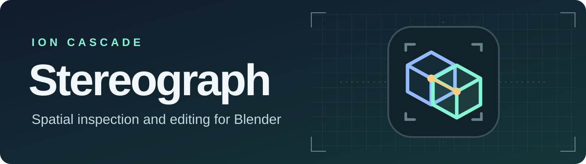

  

  <strong>An independent MCP server and Blender add-on.</strong>

  

  <a href="https://github.com/ion-cascade/stereograph/releases/latest">Download latest release</a> ·
  <a href="docs/connection.md">Set up</a> ·
  <a href="docs/motion-review.md">Motion review</a> ·
  <a href="docs/elbow-editing.md">Elbow editing</a>

Stereograph connects an MCP client to Blender for scene inspection, documentation lookup, workspace navigation, screenshots, rendering, spatial inspection, motion contact review, and bounded FK elbow edits. It can open a specified file in background Blender for inspection, rendering, and trusted Python execution. Start with the [connection guide](docs/connection.md) and [Blender Lab compatibility matrix](docs/parity.md).

## Roadmap

| Milestone | Deliverable |
| --- | --- |
| 0.1 · Connection and execution | Connect a local MCP client to live and background Blender. Verify version reporting, structured errors, timeouts and recovery on disposable scenes. |
| 0.2 · Blender Lab parity | Qualify the standard tool set against Blender Lab MCP 1.0.3. Record the live and headless support for each tool. |
| 0.3 · Comparative qualification | Run both servers against the same fixtures and compare correctness, reliability, latency and recovery. |
| 0.4 · Spatial inspection | Add read-only evaluated-geometry queries, contact and containment checks, frame sampling, and matched viewport evidence. |
| 0.5 · Rig-aware pose editing | Preview, verify, and apply an FK elbow edit with a planted hand and native Blender Undo. |
| 0.6 · Contact and motion review | Check phase-specific contact across an animation, inspect exact witnesses, and compare revisions. |

[GitHub milestones](https://github.com/ion-cascade/stereograph/milestones) · [Tool parity checklist](docs/parity.md) · [Architecture and acceptance gates](docs/roadmap.md) · [Benchmark method](docs/benchmarking.md) · [Spatial inspection guide](docs/spatial-inspection.md) · [Elbow editing guide](docs/elbow-editing.md) · [Motion review guide](docs/motion-review.md)

## Development and releases

The server and Blender add-on are independently written. Blender Lab is the behavioural reference for the standard tool set, and Blender supplies native scene evaluation, geometry, animation and rendering.

[Contributing](CONTRIBUTING.md) · [Changelog](CHANGELOG.md) · [Release process](docs/releases.md) · [GitHub releases](https://github.com/ion-cascade/stereograph/releases)

Maintained by Ion Cascade, the team behind [Conductor for Apple Logic Pro](https://github.com/ion-cascade/conductor). [Attribution](NOTICE.md) · [MIT licence](LICENSE)
