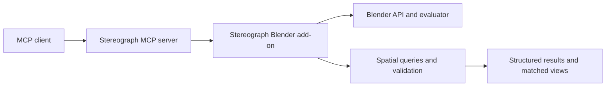

# Architecture and acceptance gates

Stereograph has three components. The MCP server handles the client protocol and schemas. The Blender add-on adapts those operations to the installed Blender version and its main-thread evaluator. The spatial package handles reusable queries and validation over evaluated state.

### 0.1 · Connection and execution

Implement local stdio MCP and a Blender session adapter with a negotiated protocol version. Provide a health query and controlled Python execution for live and background sessions. Verify both against disposable Blender files. Cover unavailable Blender, wrong session, malformed requests, execution errors, timeouts and reconnect. Record the host and Blender versions and publish independently reviewable native evidence.

### 0.2 · Blender Lab parity

Implement and qualify the [26-tool baseline](parity.md), including file summaries, object inspection, viewport navigation, capture, rendering and versioned documentation search. Run comparable requests against the official server and record intentional differences. Standard features must reach this gate before feature differentiation.

### 0.3 · Comparative qualification

Use equivalent Blender builds and fixture inputs. Compare correct results, failed-request recovery, median and tail response times and the time spent evaluating Blender versus moving data. Keep the raw results. Base each outperformance claim on a reproducible comparison. See the [benchmark method](benchmarking.md).

### 0.4 · Spatial inspection

Expose one read-only inspection operation for evaluated surfaces, named pairs, contact and separation witnesses, containment, fractional-frame sampling and matched views. Calibrate on clear, touching, crossing, nested and subframe-only failures. Review a synthetic hand and handle first, then run a read-only check of the saved knight handoff. See the [spatial inspection guide](spatial-inspection.md).

### 0.5 · Rig-aware pose editing

Qualify one planted-hand FK elbow edit from preview to native Undo. Version the rig profile and support world and moving prop anchors. Record wrist angle, hand drift, segment lengths and evaluated surface clearance at the target frame and four neighbours. Verify accepted and rejected candidates on repeatable fixtures and run the workflow on a disposable knight copy. See the [elbow editing guide](elbow-editing.md).

### 0.6 · Contact and motion review

Review named surfaces through a frame range with phase-specific clearance and contact rules. Measure fractional frames, retain matched witnesses and compare revisions using the same sampling and framing. Qualify a subframe-only crossing on a synthetic fixture and the left-hand transfer on a disposable production copy. See the [motion review guide](motion-review.md).

### 0.7 · Rig inspection and repair

Map people and other articulated rigs through explicit roles. Inspect rest fit, posed controls, skin influences and regional motion, and link sampled contact evidence. Qualify one planted-foot knee tracking edit on a native two-bone IK pole, with an undoable Action variant. See the [rig inspection guide](rig-inspection.md).

### 0.8 · Clothing and armour fit

Map clothing and armour layers, inspect evaluated stack dependencies and cloth cache status, and measure seam drift, contact and local deformation. Qualify a feathered pose-dependent corrective with protected trim, adjacent frame checks, explicit live apply and native Undo. See the [clothing fit guide](clothing-fit.md).
