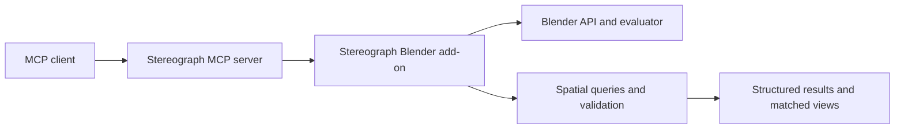

# Architecture and acceptance gates

Stereograph has three components. The MCP server handles the client protocol and schemas. The Blender add-on adapts those operations to the installed Blender version and its main-thread evaluator. The spatial package handles reusable queries and validation over evaluated state.

### 0.1 · Connection and execution

Implement local stdio MCP and a Blender session adapter with a negotiated protocol version. Provide a health query and controlled Python execution for live and background sessions. Verify both against disposable Blender files. Cover unavailable Blender, wrong session, malformed requests, execution errors, timeouts and reconnect. Record the host and Blender versions and publish independently reviewable native evidence.

### 0.2 · Blender Lab parity

Implement and qualify the [26-tool baseline](parity.md), including file summaries, object inspection, viewport navigation, capture, rendering and versioned documentation search. Run comparable requests against the official server and record intentional differences. Standard features must reach this gate before feature differentiation.

### 0.3 · Comparative qualification

Use equivalent Blender builds and fixture inputs. Compare correct results, failed-request recovery, median and tail response times and the time spent evaluating Blender versus moving data. Keep the raw results. Base each outperformance claim on a reproducible comparison. See the [benchmark method](benchmarking.md).

### 0.4 · Spatial inspection

Expose one read-only inspection operation for evaluated surfaces, named pairs, contact and separation witnesses, containment, fractional-frame sampling and matched views. Calibrate on clear, touching, crossing, nested and subframe-only failures. Review a synthetic hand and handle first, then run a read-only check of the saved knight handoff.

### Later · Pose validation and candidate solving

Add versioned rig profiles for joint axes, limits, semantic surfaces and authored grip references. Use bounded candidate solves on disposable fixtures. Require actual surface checks and visual review before a candidate becomes an edit to an authored scene.
